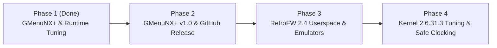

# RS-97 Plus / RetroFW Modernization Roadmap

A staged plan to modernize the RS-97 Plus (Ingenic JZ4760B) software stack from the frontend down to userspace and kernel, keeping every step reversible and safe.

---

## Phase 1: GMenuNX+ Modern & Immediate Runtime Tuning (Live Now)

### Completed in [gmenunx-plus](file:///home/sean/gmenunx-plus)
- **Live Unified Quick Search (`X`)**: Split-screen 320×240 keyboard + live ranked results across apps, games, and the full ROM library, with `v2` automatic directory `mtime` incremental indexing.
- **In-Game Performance HUD (`libperfhud.so`)**: 16 KB `LD_PRELOAD` overlay hooking SDL 1.2 & SDL 2 with zero flicker, live color-coded FPS, `/proc/stat` CPU%, and read-only JZ4760B CPM MHz readout — enabling per-emulator underclocking for battery life.
- **Playtime & Launch Tracker**: Monotonic `/proc/uptime` session tracking (immune to unset RTC), displayed in status bar, list view, and **Settings → Playtime**.
- **Favourites Superpowers**: Clean ROM display names (hiding `004 `/`010 ` prefixes), sorting (**A-Z**, **Most Played**, **Recently Played**, **Custom**), and **Pin to Top / Move Earlier / Move Later**.
- **Marquee Scrolling**: Smooth horizontal scroll for overflowing selected titles in Main Menu, Selectors, and Quick Search.
- **Recents Tab & Bulletproof Boot Restore**: Last 24 launched games/ROMs (most recent first) plus section-name + title persistence so boot always lands back on your last Favourite.
- **Battery % & Low-Battery Alerts**: Smoothed Li-ion percentage beside the battery icon (amber ≤ 20%, red ≤ 10%) with warning toasts at 15% and 5%.
- **Smart Letter Jump**: `L`/`R` first-item letter stepping with floating HUD badge, `# A–Z` picker grid, and `Y` in-folder filter.

### Immediate RetroFW 2.3 Runtime Tuning (Applied via `autoexec.sh`)
Runs once per boot as `root` with zero firmware risk:
- **SD I/O Scheduler**: Switches `mmcblk0`/`mmcblk1` from spinning-disk `cfq` → `noop`.
- **SD Read-Ahead**: Sets `read_ahead_kb = 256` for faster sequential ROM & OPK loads.
- **VM & Cache Tuning**: `vm.swappiness=20` (reduces slow SD-card swap thrashing on 64 MB RAM), `vm.vfs_cache_pressure=50` (keeps FAT32 ROM directory metadata cached longer), `vm.dirty_background_ratio=5` / `vm.dirty_ratio=15`.

> [!TIP]
> **Fast USB Dev Workflow (Already Built Into RetroFW 2.3!)**
> RetroFW 2.3 already runs `ftpd -w /` and `telnetd` on `169.254.1.1` when you connect USB and pick **Charger** (`retrofw network on`). We can add a one-line `deploy-usb.sh` script to push updated binaries over USB cable in ~1 second without popping the SD card!

---

## Phase 2: GMenuNX+ v1.0 Polish & Public GitHub Release

### Frontend Polish
- **Dual-SD (SD1 + SD2) Quick Search & Hot-Swap Refresh**: Automatically scan SD2 ROM folders and refresh SD2 OPKs on `MMC_INSERT` / `MMC_REMOVE` without rebooting.
- **Box Art / Screenshot Thumbnails**: Show `.images/` or `selectorscreens` previews alongside Quick Search results and Recents.
- **Custom Collections / Tags**: User playlists (e.g., *Currently Playing*, *Roguelikes*, *RPGs*) assignable from Search, Recents, or Selectors.
- **Quick Switcher Overlay**: Optional hotkey showing your last 6–8 played games as fast cards with playtime.
- **USB Deploy Helper**: `scripts/deploy-usb.sh` to push `gmenunx` + `libperfhud.so` straight to `169.254.1.1` via FTP.

### Public Release Checklist (GPL v2)
- Keep clean GPL v2 attribution to `retrofw/gmenunx` and Massimiliano Torromeo's original GMenu2X (`COPYING` + `about.txt`).
- Ship a **one-click installer OPK / ZIP** so any RetroFW 2.3 user (RS-97, RS-97 Plus, RG-300, LDK, Retro Arcade Mini) can install and uninstall cleanly without touching `rootfs.squashfs`.
- Include crisp screenshots/GIFs (using `START (hold)` screenshots right from your RS-97 Plus!) in the GitHub `README.md` and release notes.

---

## Phase 3: RetroFW 2.4 Userspace & Emulator Fork (`buildroot-retrofw-2.3` + `recovery`)

> [!NOTE]
> All rootfs experiments stay 100% safe: `sdf1` (`rootfs`) is a plain 128 MB FAT32 partition with 70 MB free, so we always keep `rootfs.squashfs.2.3.bak` right beside test images.

- **Fork & Mirror `retrofw/buildroot-retrofw-2.3` (`2021.11.x`)**:
  - Immediately populate and archive a local `dl/` source tarball mirror to guard against upstream URL rot.
  - Replicate a byte-verified baseline `rootfs.squashfs` build first before modifying packages.
- **Bake Modern Components Natively**:
  - Integrate **GMenuNX+ Modern** and **`libperfhud.so`** directly into `/usr/bin/gmenunx` and `/usr/lib/libperfhud.so`.
  - Add **`dropbear` (SSH/SCP/SFTP)** over USB Ethernet for clean, modern cable deployment.
  - Streamline `/usr/bin/retrofw` (`retrofw/recovery`) startup for faster cold boot.
- **Core Library Performance Upgrades**:
  - Drop-in **`zlib-ng`** for faster `.zip` ROM loading, PNG decoding, and OPK decompression.
  - Update **SDL2** (2.0.16 → 2.30+), `libpng`, `libjpeg-turbo`, and `freetype`, and audit SDL 1.2's IPU/vsync double-buffering path.
- **Emulator Rebuilds (`-O3 -flto` + Upstream Fixes)**:
  - Rebuild key 2020–2021 RetroFW emulators (`pocketsnes`, `pcsx4all`, `picodrive`, `regba`, `gambatte`, `fceux`, `fba-sdl`) with GCC 11.2+ and `-O3 -flto`, pulling proven MIPS/OpenDingux/MiyooCFW improvements where applicable (target: +10–20% FPS headroom and lower power draw).

---

## Phase 4: Kernel 2.6.31.3 Tuning & Safe Clocking (`retrofw/kernel`)

Stay on Ingenic's proven `2.6.31.3` hardware base (preserving 100% RS-97 Plus `LKWY030A01` panel & binary compatibility) while applying surgical, high-value kernel upgrades:

1. **Scheduler & Memory Config (`RetroFW_defconfig`)**:
   - Set `CONFIG_DEFAULT_IOSCHED="noop"` natively.
   - Test `CONFIG_HZ_250=y` + `CONFIG_PREEMPT_VOLUNTARY=y` for tighter 60 fps frame pacing and lower audio latency.
   - Disable `CONFIG_SLUB_DEBUG` to reclaim RAM and allocator cycles.
2. **Compressed RAM Swap (`ramzswap` / LZO)**:
   - Backport/enable LZO `ramzswap` (the 2.6.31 predecessor to `zram`) as priority-1 swap ahead of `mmcblk0p2`, giving heavy ports (Cataclysm-DDA, 7KAA, roguelikes) ~20–30 MB of fast in-RAM virtual memory before hitting slow SD swap.
3. **Kernel-Side `/proc/jz/clock` Driver (Salvaging Overclocking & Underclocking)**:
   - Dump exact RS-97 Plus boot `CPPCR0`/`CPCCR`/`DDRC`/`LPCDR` registers first.
   - Implement a proper in-kernel frequency switch (masking IRQs, executing from on-chip TCSM SRAM, scaling `DDRC_REFCNT` and LCD `LPCDR` atomically) — enabling **rock-solid deep underclocking (240–450 MHz)** and **clean, stable overclocking (660–702+ MHz)** without userspace `/dev/mem` hangs.
4. **Ingenic MXU SIMD Investigation**:
   - Profile hotspots in SDL 1.2 blitting and core emulators to see where JZ4760B MXU SIMD yields the biggest real-world FPS gains.
